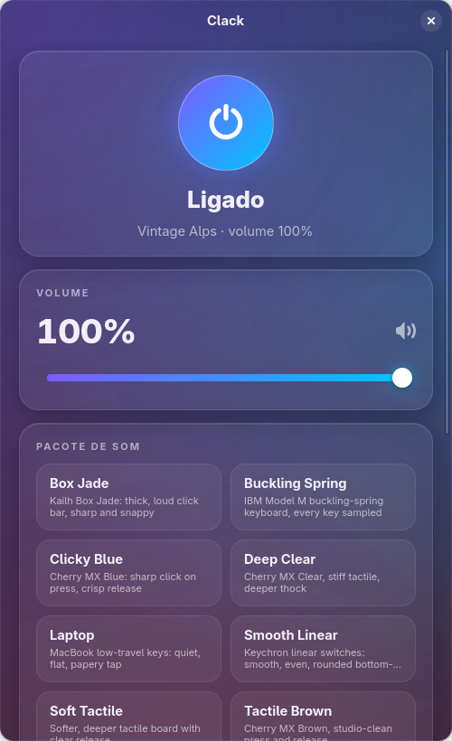
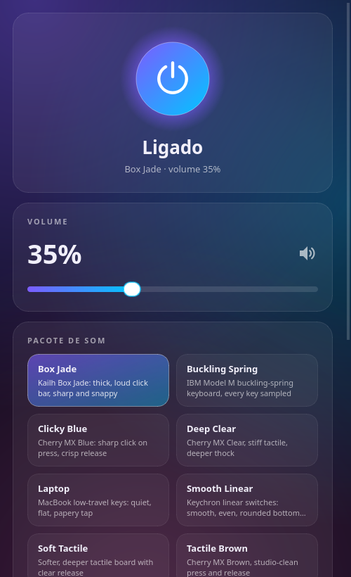

# Clack

Sons de teclado mecânico enquanto você digita, em qualquer programa. Funciona no **Linux**, no **Windows** e no **macOS**.

Vem com 11 pacotes de som gravados de teclados de verdade: Cherry MX Blue, Brown e Clear, IBM Model M, Topre, Alps, máquina de escrever e outros.

| Linux (GNOME) | Windows e macOS |
|---|---|
|  |  |

## Download

Baixe a versão mais recente na página de **[Releases](https://github.com/Lobbyboya/clack/releases/latest)**:

| Sistema | Arquivo |
|---|---|
| Windows 10/11 | `Clack-x.y.z-windows-x64-setup.exe` (instalador) ou `…-portable.zip` (sem instalar) |
| macOS com chip Apple (M1 ou mais novo) | `Clack-x.y.z-macos-arm64.dmg` |
| macOS com processador Intel | `Clack-x.y.z-macos-intel.dmg` |
| Linux | `clack-x.y.z-linux.tar.gz` |

### Windows

1. Rode o instalador. Ele instala só para o seu usuário e não pede senha de administrador.
2. O app não tem assinatura digital paga. Por isso o Windows pode mostrar "O Windows protegeu o computador". Clique em **Mais informações** e depois em **Executar assim mesmo**.
3. Ao fechar a janela, o Clack continua tocando e fica na bandeja, perto do relógio. Para encerrar, use **Sair do Clack** no app ou no menu do ícone da bandeja.

### macOS

1. Abra o `.dmg` e arraste o **Clack** para a pasta **Aplicativos**.
2. Na primeira vez, clique no app com o botão direito e escolha **Abrir**, porque ele não é assinado pela Apple. Se o macOS disser que o app "está danificado", rode isto no Terminal:
   ```sh
   xattr -dr com.apple.quarantine /Applications/Clack.app
   ```
3. Para ouvir o teclado, o macOS pede a permissão **Monitoramento de Entrada**. Ative o Clack em *Ajustes do Sistema › Privacidade e Segurança › Monitoramento de Entrada* e reabra o app. O botão **Reabrir o Clack** no próprio app faz isso.
4. O ícone fica na barra de menus.

### Linux

Funciona no Wayland e no X11, porque lê o teclado direto pelo `evdev`. Requisitos: Python 3.11 ou mais novo, PortAudio e, para o painel gráfico, GTK4 com libadwaita.

```sh
# Arch / CachyOS / Manjaro
sudo pacman -S python python-evdev portaudio python-gobject gtk4 libadwaita
# Debian / Ubuntu
sudo apt install python3 python3-venv python3-evdev libportaudio2 python3-gi gir1.2-adw-1

tar -xzf clack-*-linux.tar.gz
cd clack-*-linux
./install.sh
```

O instalador não usa `sudo`. Ele copia o app para `~/.local/share/clack`, cria o comando `clack`, coloca o atalho **Clack** no menu de aplicativos e liga o serviço `systemctl --user`.

Para ler o teclado, seu usuário precisa estar no grupo `input`. Depois de rodar o comando abaixo, saia e entre de novo na sessão:

```sh
sudo usermod -aG input $USER
```

Também dá para controlar pelo terminal:

```sh
clack status          # estado, pacote, volume e teclados detectados
clack volume 40       # 0 a 100
clack pack            # lista os pacotes
clack pack topre      # troca o pacote
clack on | off | toggle
```

Para desinstalar, rode `~/.local/share/clack/uninstall.sh`. Suas preferências continuam em `~/.config/clack`.

## Privacidade

O Clack só olha **qual tecla física** foi apertada, para escolher o som. Ele não guarda o que você digita, não grava nada em arquivo e não usa a internet.

## Bateria

O Clack foi ajustado para notebook. Medido no Linux com PipeWire:

| Situação | CPU (Clack + servidor de áudio) | Vezes que acorda a CPU |
|---|---|---|
| Parado (sem digitar) | 0% | 0 por segundo |
| Digitando sem parar | ~5% | ~200 por segundo |

O que faz isso funcionar:
- **O áudio dorme quando não há som.** Depois de 1,5 s sem tecla, o fluxo de áudio fecha. Por isso a primeira tecla depois de uma pausa sai uns 20 ms mais tarde.
- **O áudio trabalha em blocos de 512 amostras.** Isso gasta metade da CPU do bloco de 128, com só ~3 ms a mais de atraso.
- **Nada acorda periodicamente.** No Linux, o kernel avisa pelo `inotify` quando um teclado é ligado ou desligado. No Windows e no macOS, o gancho do sistema só chama o Clack quando há tecla. A janela só se atualiza quando está visível.

## Como funciona

| | Linux | Windows | macOS |
|---|---|---|---|
| Leitura do teclado | `evdev` (`/dev/input`) | gancho `WH_KEYBOARD_LL` com o scancode físico | event tap do Quartz, só de escuta |
| Interface | GTK4 + libadwaita, com um daemon separado no systemd | Qt (PySide6), na bandeja | Qt (PySide6), na barra de menus |
| Áudio | PortAudio (`sounddevice`), mixer de baixa latência em NumPy | mesmo | mesmo |

Os pacotes de som (`packs/*/pack.json`) usam os códigos de tecla do Linux. `clack/keymap.py` traduz os códigos do Windows e do macOS para eles, então cada tecla soa igual nos três sistemas.

## Desenvolvimento

```sh
python -m venv .venv && . .venv/bin/activate
pip install -r requirements-desktop.txt pytest ruff pyinstaller
pip install evdev                              # só no Linux
ruff check . && QT_QPA_PLATFORM=offscreen pytest
python desktop/clack_desktop.py                # app Qt pelo código-fonte
pyinstaller desktop/clack.spec --noconfirm     # gera dist/Clack (ou dist/Clack.app)
dist/Clack/Clack --selftest resultado.json     # autoteste do app empacotado
```

O GitHub Actions (`.github/workflows/build.yml`) roda os testes nos três sistemas, gera os pacotes e testa cada um deles. No Windows, ele injeta teclas de verdade e instala e desinstala o app. No macOS, ele monta o `.dmg`. Ao receber uma tag `vX.Y.Z`, ele publica a release.

## Licenças

O código usa a licença [MIT](LICENSE). Os sons têm licenças próprias, listadas em [SOUNDS-LICENSES.md](SOUNDS-LICENSES.md). Quase todos são CC0. Alguns são CC BY 4.0, e os créditos estão no arquivo. O pacote Buckling Spring é GPL-2.0.
